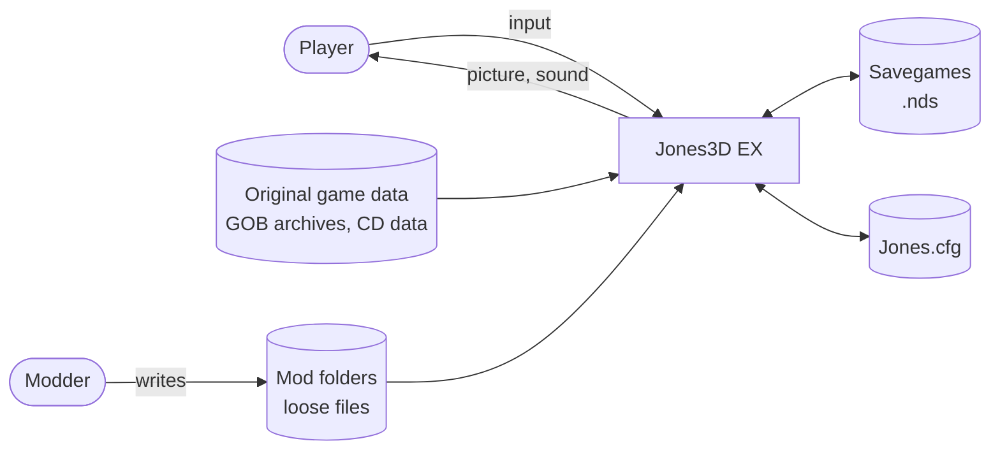
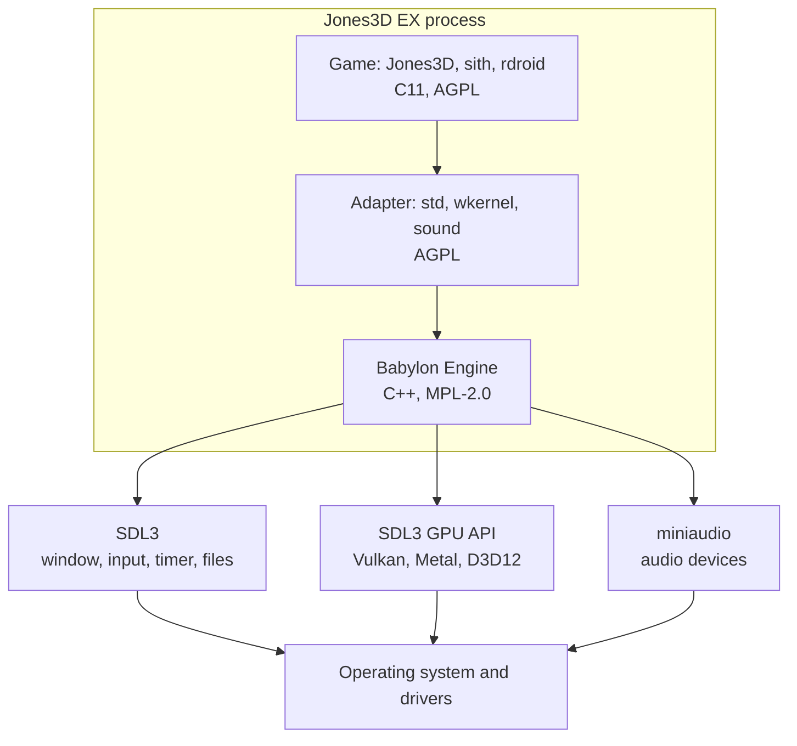

# 3. Context and scope

## 3.1 Business context

| Partner | Input | Output |
|---|---|---|
| Player | Keyboard, mouse, gamepad | Picture, sound, savegames |
| Original game data | Levels, models, materials, sounds, COG scripts from the player's copy of the game | |
| Savegames | Original-format savegames, also from the original game | Savegames in the same format |
| `Jones.cfg` | Settings | Changed settings |
| Mod folders | Files that override or add game data | |

Out of scope: online services, store integrations (Steam, GOG), achievements. Multiplayer code keeps
compiling but has no supported network backend.

## 3.2 Technical context

| Channel | Technology | Owned by |
|---|---|---|
| Window, input, timers, file system | SDL3 | Babylon backend |
| Graphics | SDL3 GPU API, which maps to Vulkan, Metal or Direct3D 12 | Babylon backend |
| Audio output | miniaudio | Babylon backend |
| Game files | Original GOB archives and loose files, read through the game's resource code | Game |
| Headless runs | No window, no device: null backends, scripted input, state trace output | Babylon null backends plus the game's headless runner |

Until the new renderer reaches parity (milestone M6), the legacy Win32 and DirectX 9 path still exists on
Windows, outside Babylon. It is the visual reference for the new renderer, and is removed after that.
