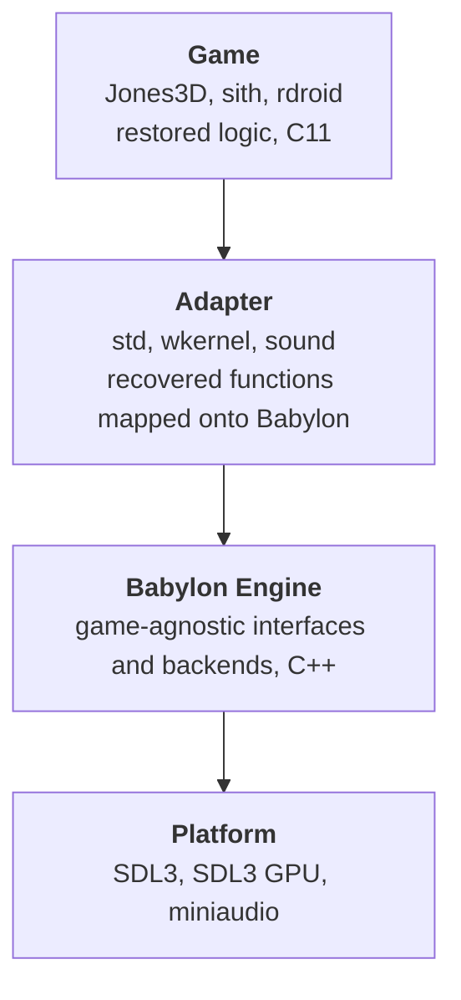

# 4. Solution strategy

## 4.1 Three layers

| Layer | Owns | Doesn't know about |
|---|---|---|
| Game | Worlds, things, physics, AI, COG, savegames, HUD, menus | Any platform or API |
| Adapter | The recovered platform functions the game calls (`std3D_*`, `stdControl_*`, `Sound_*`, `wkernel_*` and similar), implemented by calling Babylon | Backends; it sees only Babylon's interfaces |
| Babylon Engine | Window, input, timing, files, rendering, audio, cvars, threads; one interface per role, several backends per interface | Jones3D, Sith, or any game |
| Platform | Operating system and device access | |

Dependencies only point down. Babylon never includes anything from the game or the adapter, and CI proves
it: Babylon builds and runs its tests on its own, an include check rejects paths outside `Babylon/`, and a
license check rejects non-permissive dependencies.

## 4.2 Key ideas

| Goal | Approach | Details |
|---|---|---|
| Fidelity | The simulation keeps the original logic. Headless runs from savegames with scripted input write state traces, which are compared frame for frame against a reference build | [ADR-0003](09-decisions/ADR-0003-fidelity-split.md) |
| Freedom where it doesn't hurt | Presentation (rendering, resolution, audio, UI) is enhanced by default. Enhancements are on by default, OpenJones3D's QOL changes and new simulation changes alike, each a runtime option that returns to retail; the Retail profile turns them all off | [ADR-0003](09-decisions/ADR-0003-fidelity-split.md) |
| Separability | Babylon is a self-contained directory with its own tests, license and CI job | [ADR-0006](09-decisions/ADR-0006-babylon-engine-in-repo.md), [ADR-0008](09-decisions/ADR-0008-babylon-license.md) |
| Unchanged game code | The game keeps calling the recovered functions it always called. Only their bodies change, into adapters | [ADR-0007](09-decisions/ADR-0007-adapter-between-game-and-babylon.md) |
| Portability | SDL3 for the platform, the SDL3 GPU API for graphics, miniaudio for audio: one backend each reaches Windows, Linux and macOS | [ADR-0009](09-decisions/ADR-0009-sdl3-and-sdl3-gpu.md), [ADR-0010](09-decisions/ADR-0010-miniaudio.md) |
| Testability | Every Babylon interface has a null backend. The whole game runs headless, which is how traces are made | [ADR-0012](09-decisions/ADR-0012-desktop-first-portable-interfaces.md) |

## 4.3 How we get there

The work is ordered so that something runs at every step. See the [roadmap](../Roadmap.md) for status.

| Milestone | Result |
|---|---|
| M5. Babylon foundation | `Babylon/` with tests, SDL3 window, input, timer and files, null backends, cvars, adapters. CI on Windows, Linux and macOS |
| M6. Babylon renderer | SDL3 GPU renderer at parity with DirectX 9, then the Win32 and DirectX path is removed |
| M7. Playable | Sound through miniaudio, the original dialogs as in-game screens, playable on all three platforms |
| M8. Release | Packages, game data installation, macOS signing, first release |
| M9. Presentation | Widescreen, high resolution, bloom and depth of field, high frame rates |
| M10. Modern lighting | Per-pixel dynamic lighting and ambient occlusion on the existing CPU pipeline; vertex lighting stays as classic mode |
| M11 and later. Babylon extras | Visible console, modding, threading; shadows and GPU geometry as an open idea |

The graphics enhancements are presentation, so they may change how the game looks but never the trace. M10
keeps the CPU transform and clipping and only hands the GPU more per vertex (view-space position and normal);
moving geometry to the GPU for shadows would be a second render path and is not planned.

Threading comes last on purpose: running game logic and rendering in parallel is the change most likely to
break determinism, so it waits until traces guard everything else.
