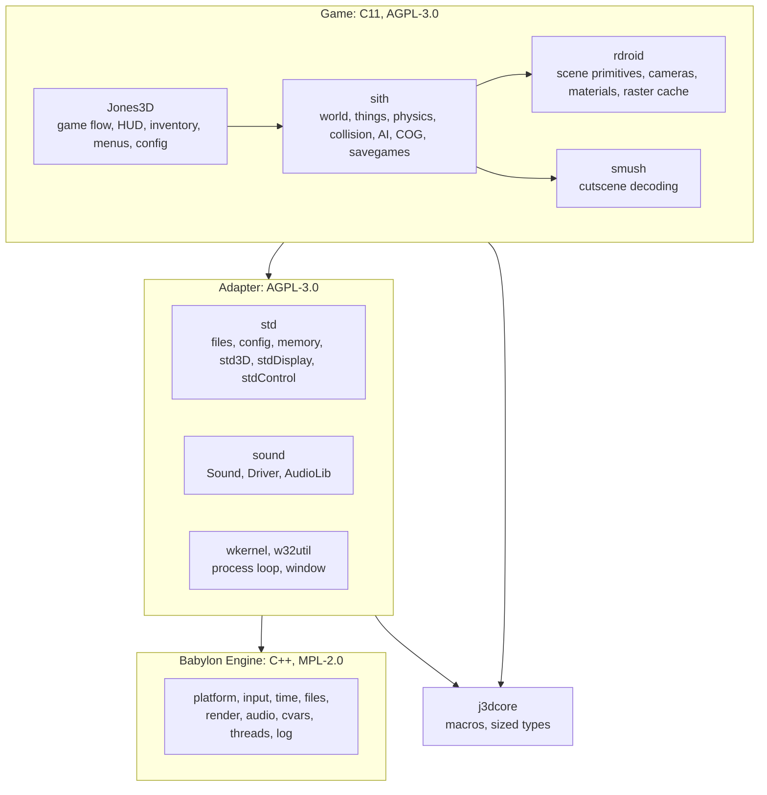

# 5. Building block view

## 5.1 Level 1: the whole system

| Building block | Responsibility | Interface | Where |
|---|---|---|---|
| Jones3D | Application: startup, menus, HUD, inventory, level flow, configuration | Called by the host loop | `Jones3D/` |
| sith | Gameplay runtime: worlds, things, physics, collision, AI, COG VM, cameras, savegames | `sith*` functions | `Libs/sith/` |
| rdroid | Renderer-facing primitives: cameras, materials, models, keyframes, the raster cache | `rd*` functions | `Libs/rdroid/` |
| smush | Cutscene (SMUSH/SAN) decoding | `smush*` functions | `Libs/smush/` |
| Adapter | The recovered platform functions the game calls, mapped onto Babylon | `std*`, `Sound_*`, `Driver_*`, `wkernel_*` | `Libs/std/`, `Libs/sound/`, `Libs/wkernel/`, `Libs/w32util/` |
| Babylon Engine | Game-agnostic platform framework: one interface per role, several backends | C++ interfaces in `Babylon/` | `Babylon/` (from M5) |
| j3dcore | Lowest support layer: macros and sized types shared by game and adapter | `j3d.h` | `Libs/j3dcore/` |

Dependencies only point down. Babylon depends on nothing above it, and nothing in Babylon names a Jones3D
or Sith concept ([ADR-0006](../09-decisions/ADR-0006-babylon-engine-in-repo.md),
[ADR-0007](../09-decisions/ADR-0007-adapter-between-game-and-babylon.md)).

**Today (end of M5):** three platform columns exist side by side, chosen at configure time. The Win32 and
DirectX 9 column and the Null column are the M3 and M4 backends described in
[Platform-Layer.md](Platform-Layer.md). The **Babylon column** (`-DJONES3D_PLATFORM_BABYLON=ON`, non-Windows)
is the Null column with time, files, input and the window moved onto Babylon; rendering and sound still use
the Null backends until M6 and M7. Both non-Windows columns produce identical headless traces.

## 5.2 Level 2: Babylon Engine

Modules marked M5 exist and are used by the Babylon column; the others are still planned.

| Module | Role | Backends | Adapter that uses it | State |
|---|---|---|---|---|
| core | Shared types, version, locale-free number parsing | | | M5 |
| Log | Leveled logging with sinks | | | M5 (the game still logs through `STDLOG_*`) |
| Platform | Windows and the one event queue (window, key, mouse and gamepad events) | SDL3, Null | `wkernelBabylon.cpp`, `stdBabylonEvents.cpp` | M5 |
| Input | Input state built from platform events; input scripts (ADR-0018) | none of its own: events come from Platform or a script | `stdControlDevicesBabylon.cpp` | M5 (keys and mouse buttons; mouse axes and gamepads later) |
| Time | Monotonic clock and a caller-driven Null clock | SDL3, Null | `stdPlatformTimeBabylon.cpp` | M5 |
| Files | Files, directory listing, base, current and user directories | SDL3, Null | `stdFileBabylon.cpp`, `stdFileUtilBabylon.cpp`, `stdBabylonPath.cpp` | M5 |
| Cvars | Named, typed settings with flags, ranges and change callbacks (ADR-0020) | | `stdCvarBabylon.cpp` (`game.profile`) | M5 |
| Render | Devices, textures, buffers, shaders, draw submission | SDL3 GPU, Null | `std3D`, `stdDisplay` | M6 |
| Audio | Devices, voices, 3D positioning, streaming | miniaudio, Null | `Driver_*` | M7 |
| Threads | Threads, jobs, synchronization | SDL3 | | M11 and later |

The adapter files live in `Libs/std/Babylon/` and `Libs/wkernel/`; they reach Babylon through one context
pointer (`Libs/std/Babylon/stdBabylon.h`) that the composition root fills
(`Jones3D/Platform/Babylon/main.cpp` for `Jones3D-headless`, `mainWindowed.cpp` for the windowed `Jones3D`).

Each module is its own CMake target with a public `include/` and a private `src/`, and may only use the
modules it declares ([ADR-0015](../09-decisions/ADR-0015-babylon-modules-as-cmake-targets.md)).

Every module has a Null backend that honors the interface's contract without a device. Null backends let
the whole game run headless, which is how traces are recorded ([chapter 8](../08-crosscutting/README.md)).

## 5.3 Level 2: game subsystems

These pages describe the game's subsystems as they are today:

| Page | Covers |
|---|---|
| [Quick-Reference.md](Quick-Reference.md) | A short mental model of the whole engine: layers, worlds and things, sectors and adjoins |
| [World-And-Resources.md](World-And-Resources.md) | `SithWorld`, world loading, section parsing, resource ownership |
| [Collision-System.md](Collision-System.md) | Movement tracing, hit collection, handler dispatch, line of sight, collision response |
| [Control-And-Input.md](Control-And-Input.md) | Raw input backends, logical bindings, idle detection, control intent |
| [Camera-System.md](Camera-System.md) | System cameras, interpolation, camera collision, cutscene cameras |
| [Rendering-And-Visibility.md](Rendering-And-Visibility.md) | Camera stack, sector visibility, PVS, thing and light collection, dynamic lighting |
| [Scripting-AI-And-Audio.md](Scripting-AI-And-Audio.md) | COG VM, AI control blocks and awareness, the audio stack |
| [Sound-System.md](Sound-System.md) | Sound engine, gameplay mixer, sound classes, voice playback |
| [Platform-Layer.md](Platform-Layer.md) | The M3 and M4 platform layer that Babylon replaces |

Tests live beside the code they cover, in `Tests/` directories. See [Testing.md](../../Testing.md).
