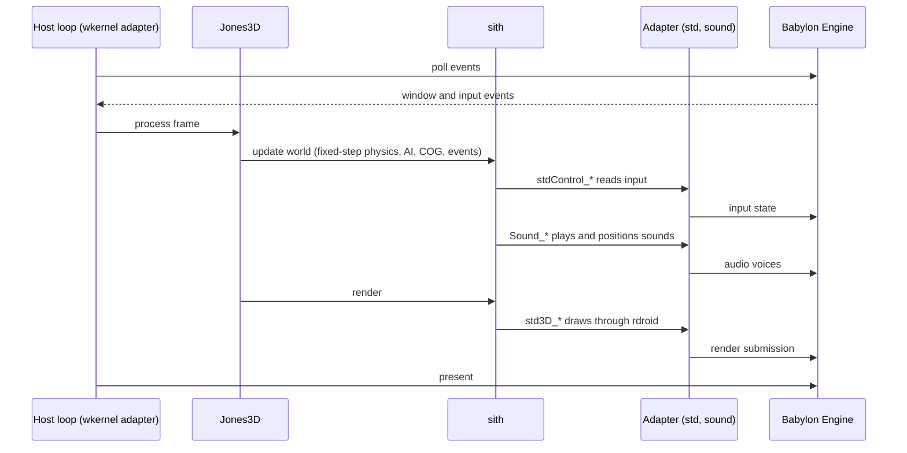
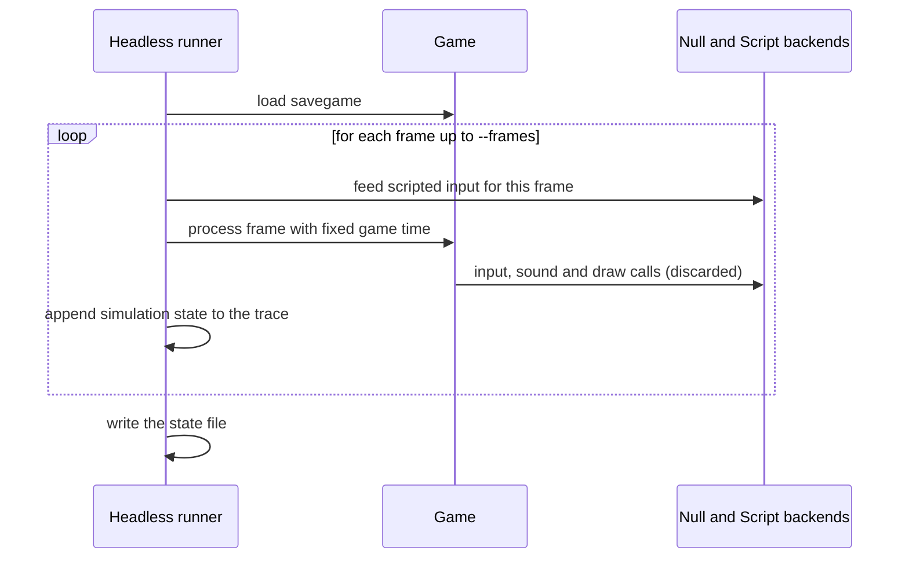

# 6. Runtime view

## 6.1 One frame

The simulation step reads only input and game time. Rendering and audio only read simulation state. That
split is what makes headless traces possible: replace the window, input, audio and render backends with
Null and Script backends, and the simulation produces the same state.

## 6.2 Scenarios

| Page | Covers |
|---|---|
| [Boot-And-Lifecycle.md](Boot-And-Lifecycle.md) | Process startup, subsystem startup, opening a world, shutdown |
| [Frame-Loop-And-Simulation.md](Frame-Loop-And-Simulation.md) | Update order, timing, events, things, physics, collision within a frame |
| [Event-And-Message-Systems.md](Event-And-Message-Systems.md) | Deferred events, COG message dispatch, the multiplayer and file synchronization bus |

## 6.3 A headless trace run

Today: `Jones3D-headless --load <save> --frames <n> --state <file>`, built with the Null platform. Two runs
with the same inputs give identical state files on 32-bit, 64-bit and sanitizer builds.
