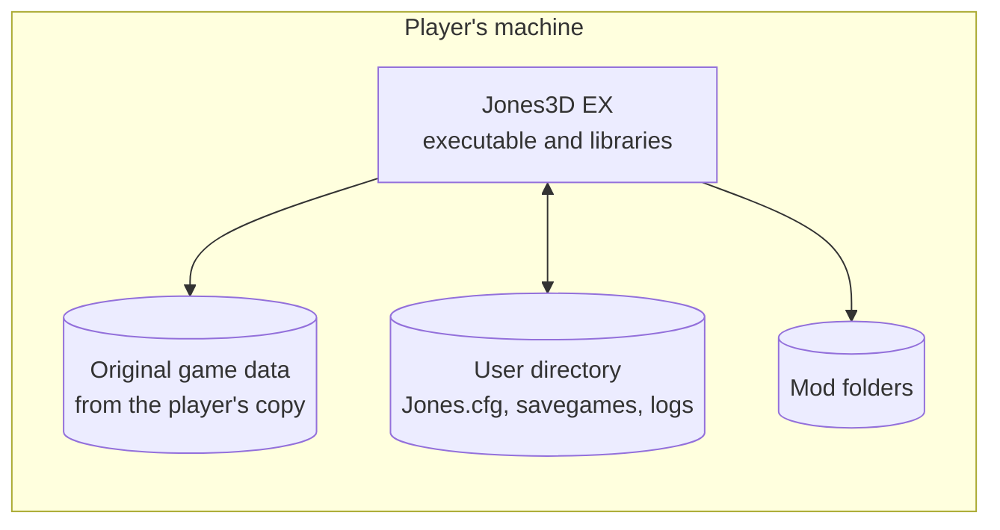

# 7. Deployment view

## 7.1 Builds

| Build | Platform | Status | Product |
|---|---|---|---|
| Windows legacy | Win32, DirectX 9, MSVC or MinGW | Works; removed after M6 | `Jones3D.exe` |
| Headless | Null platform, any OS, 32-bit or 64-bit | Works | `Jones3D-headless` |
| Windows | Babylon on SDL3 and SDL3 GPU, x86-64 | From M5 and M6 | `Jones3D.exe` |
| Linux | Babylon on SDL3 and SDL3 GPU, x86-64 | From M5 and M6 | `jones3d` |
| macOS | Babylon on SDL3 and SDL3 GPU (Metal), arm64 and x86-64 | From M5 and M6 | `Jones3D EX.app` |

CI builds and tests every Babylon build on its own operating system from M5 on.

## 7.2 What a player installs

| Part | Comes from | Where |
|---|---|---|
| Executable and its libraries (SDL3, miniaudio is compiled in) | Jones3D EX release package | Anywhere |
| Original game data | The player's copy of the game (Steam, GOG or CD), never the release package | A directory the player points to, or found automatically |
| Settings, savegames, logs | Written by Jones3D EX | Planned: the operating system's user data directory. Today: the game directory |
| Mods | The player | Planned: a mods directory beside the user data |

The details, including how game data is found and installed, are settled in M8.
