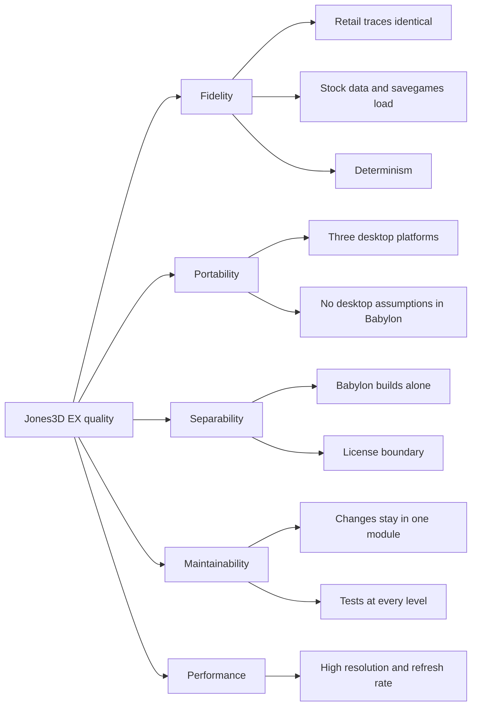

# 10. Quality requirements

## 10.1 Quality tree

## 10.2 Quality scenarios

| ID | Quality | Scenario | Expected result |
|---|---|---|---|
| F1 | Fidelity | A headless run of a savegame with scripted input, retail profile | Same state trace as the reference, frame for frame |
| F2 | Fidelity | A savegame written by the original game is loaded | It loads and plays on |
| F3 | Fidelity | The same headless run on 32-bit, 64-bit and sanitizer builds | Identical state files |
| F4 | Fidelity | A simulation option is switched off | The retail trace is identical to the reference |
| P1 | Portability | A change is pushed | It builds and passes tests on Windows, Linux and macOS |
| P2 | Portability | A new platform is added | Only new Babylon backends; no change to the game, the adapter or Babylon's interfaces |
| S1 | Separability | `Babylon/` is copied into an empty project | It builds and its tests pass |
| S2 | Separability | Someone adds an include from `Babylon/` to `Libs/` | CI fails |
| M1 | Maintainability | A backend changes | One Babylon module and its tests change, nothing above the adapter |
| M2 | Maintainability | A bug is fixed | The fix comes with a test that fails without it |
| E1 | Performance | 4K at 144 Hz on a mid-range GPU from the last five years | Steady frame rate (target to be measured in M6) |
