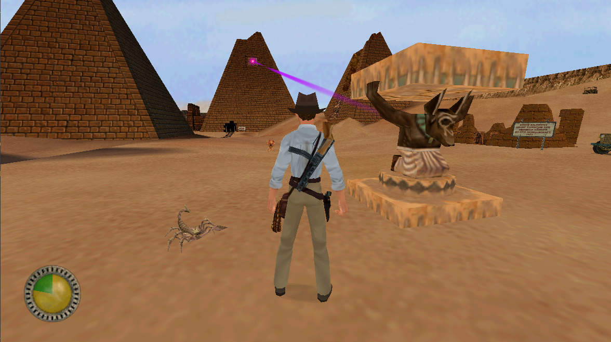

<div align="center">

# Jones3D EX
### An enhanced source port of the Jones3D engine



**[Roadmap](Docs/Roadmap.md)** • **[Architecture](Docs/arc42/README.md)** • **[Building](#building)** • **[Changelog](CHANGELOG.md)**

[](LICENSE)
[](Docs/arc42/09-decisions/ADR-0008-babylon-license.md)

</div>

## Overview

**Jones3D EX** is an enhanced source port of **Jones3D**, the engine of ***Indiana Jones and the Infernal
Machine*** (1999). Its goal is the original game on Windows, Linux and macOS, with a modern renderer and audio,
using the player's own game data and savegames.

It follows the model of the Kex engine behind Nightdive Studios' remasters: the restored original game logic
runs on a separate, game-agnostic platform framework. Here that framework is the **Babylon Engine**:

| Part | What it does | Language | License |
|---|---|---|---|
| Game | The restored Jones3D and Sith game logic: worlds, physics, AI, COG scripts, savegames | C11 | AGPL-3.0 |
| Babylon Engine | Window, input, timing, files, rendering, audio, settings, behind portable interfaces | C++ | MPL-2.0 |

Gameplay is measured against the original release: headless runs replay savegames with scripted input and
compare the simulation frame by frame. The quality-of-life changes inherited from OpenJones3D are on by
default, and each can be switched back to retail behavior. Presentation is free to improve.

This repository does **not** include any game assets. You need a legal copy of the game, for example from
[Steam](https://store.steampowered.com/app/904540) or [GOG](https://www.gog.com/en/game/indiana_jones_and_the_infernal_machine).

## Status

Jones3D EX is at the start of its own road. See the [roadmap](Docs/Roadmap.md).

- **Playable today:** on Windows, through the legacy Win32 and DirectX 9 build inherited from OpenJones3D.
- **Runs headless today:** on Linux and other systems, 32-bit and 64-bit, without a window or sound. This is
  what the behavior checks use.
- **Next:** the Babylon Engine foundation (M5), then its renderer (M6), then playable on all three platforms (M7).

## Where it comes from

Jones3D EX is a hard fork of [OpenJones3D](https://github.com/smlu/OpenJones3D), which rebuilt the engine
function by function from the retail executable, using IDA, Ghidra, debug symbols and related projects such as
[OpenJKDF2](https://github.com/shinyquagsire23/OpenJKDF2). OpenJones3D completed that reconstruction. Its
compatibility rules (hooks into the original executable, retail addresses, frozen memory layouts) existed to
check it, and are dropped here so the engine can move onto a new platform layer. The last state compatible
with OpenJones3D is tagged `upstream-compatible-final`. The reasons are in
[ADR-0001](Docs/arc42/09-decisions/ADR-0001-hard-fork.md) and
[ADR-0004](Docs/arc42/09-decisions/ADR-0004-drop-binary-compatibility.md).

Inherited from OpenJones3D, among others: a DirectX 9 renderer with widescreen and high resolutions,
`Jones.cfg` instead of the Windows Registry, high-precision frame timing, more sound channels, restored console
commands and COG functions, and many bug and crash fixes. See [CHANGELOG.md](CHANGELOG.md).

<a id="building"></a>
## Building

CMake 3.15 or newer is required.

### Windows (legacy Win32 and DirectX 9 build)

With Visual Studio:

```bat
cmake -S . -B build -G "Visual Studio 17 2022" -A Win32
cmake --build build --config Release
```

With MinGW (i686), from any host:

```bash
cmake -S . -B build/mingw -G Ninja -DCMAKE_TOOLCHAIN_FILE=cmake/mingw-i686.cmake -DCMAKE_BUILD_TYPE=Release
cmake --build build/mingw
```

Copy `Jones3D.exe` into the game's `Resource` directory and start it there. This build is removed once the
Babylon renderer reaches parity (M6).

### Linux and other systems (headless)

```bash
cmake -S . -B build/native -G Ninja -DCMAKE_C_COMPILER=clang -DCMAKE_CXX_COMPILER=clang++ -DCMAKE_BUILD_TYPE=Debug
cmake --build build/native
ctest --test-dir build/native --output-on-failure -L unit
```

This builds the unit tests and `Jones3D-headless`, which runs the game without window or sound:

```bash
cd <game>/Resource
<repo>/build/native/Jones3D/Jones3D-headless --load ../SaveGames/<save>.nds --frames 1000 --state state.txt
```

Clang is the tested compiler. GCC works but needs extra flags for now, see
[chapter 11](Docs/arc42/11-risks-and-technical-debt.md). More build profiles and the test workflow are in [Docs/Testing.md](Docs/Testing.md).

## Documentation

- [Architecture (arc42)](Docs/arc42/README.md): goals, constraints, building blocks, runtime, decisions
- [Roadmap](Docs/Roadmap.md): milestones and status
- [File formats](Docs/Formats/README.md), [COG scripting](Docs/COG/README.md), [Jones.cfg](Docs/Jones.cfg.md)
- [CONTRIBUTING.md](CONTRIBUTING.md): workflow, code style, commits
- [Testing.md](Docs/Testing.md): tests and how to run them

## License

The game code is licensed under the [GNU Affero General Public License v3.0](LICENSE), copyright OpenJones3D
contributors. The Babylon Engine in `Babylon/` is licensed separately under the Mozilla Public License 2.0, see
[ADR-0008](Docs/arc42/09-decisions/ADR-0008-babylon-license.md).

*Indiana Jones and the Infernal Machine* is © Lucasfilm Ltd. LucasArts, Indiana Jones and related properties are
trademarks of Lucasfilm Ltd. Jones3D EX is not affiliated with or endorsed by Lucasfilm, LucasArts, Disney or
Nightdive Studios.
